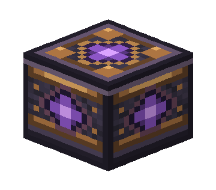
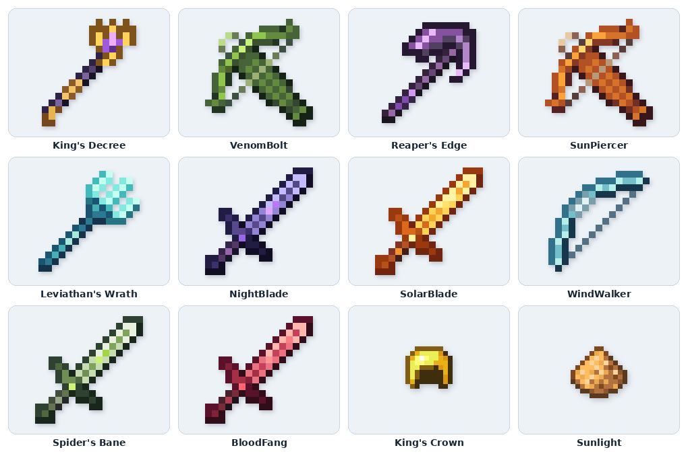
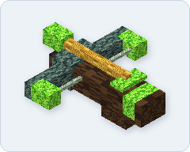
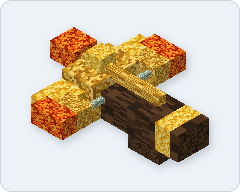
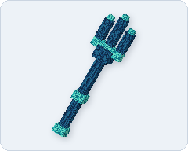
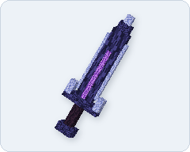
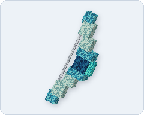
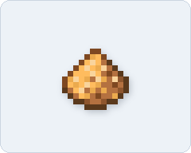

# Amplified Items

Ten custom weapons for AmplifiedSMP on **Minecraft Java 26.3**. The mod runs on Fabric servers, and players can join with vanilla Minecraft and accept the server resource pack to see the custom models.

[Install](#install) · [Controls](#controls) · [Craft a weapon](#craft-a-weapon) · [Weapons](#weapons) · [Special ingredients](#special-ingredients)

## Install

1. Use **Java 25**, **Fabric Loader 0.20.1 or later**, and **Fabric API 0.165.2+26.3** or a newer Fabric API build for Minecraft 26.3.
2. Put `amplified-items-1.6.3.jar` in the server’s `mods` folder. Replace the old Amplified Items JAR if you’re upgrading.
3. Start the server once to create or update `config/amplified-items/config.json`.
4. Set up the resource pack, then restart the server. Players should accept the pack when they join.

### Resource pack

Upload `amplified-items-resources-1.6.3.zip` to your web host and set `resourcePackPublicUrl` to the direct ZIP URL. Leave `resourcePackHostEnabled` set to `false`.

To host the pack through the mod instead, open TCP port `8190` and edit these keys in the existing config. Replace `YOUR_SERVER_IP` with your server’s public address.

```json
{
  "resourcePackHostEnabled": true,
  "resourcePackPort": 8190,
  "resourcePackPublicUrl": "http://YOUR_SERVER_IP:8190/amplified-items.zip",
  "resourcePackRequired": true
}
```

If you already distribute the pack through `server.properties`, set its URL and SHA-1 there and leave the mod’s `resourcePackPublicUrl` empty. When the mod sends the pack, players can use `/amplifieditems pack` to request it again.

## Controls

1. Hold a weapon in your main hand and press **F** to open its ability menu. If you rebound **Swap Item With Offhand**, press that key.
2. Click the ability you want. The menu closes and saves your choice for that weapon.
3. **Right-click** to cast the selected ability. The first available ability is selected by default. Its active cooldown appears in a boss bar while you hold the weapon.

Use **sneak + right-click** for normal item actions, such as drawing a bow or loading a crossbow. You can also select **Normal item use** in the menu.

## Craft a weapon



1. Find an altar placed by an admin. The floating weapon is the reward. The text above it lists the recipe.
2. Bring the ingredients in your main inventory or hotbar. Six default recipes use [PvP player heads](#pvp-player-heads). You can check a recipe with `/amplifieditems altar recipe <weapon>`.
3. Right-click the **altar block** in Survival or Adventure mode. The altar takes the ingredients, gives you the weapon, and disappears. Lightning flashes and the server announces who claimed it.

Each weapon can be claimed once per world save. Claims and unclaimed altars survive restarts.

## PvP player heads

When a player directly kills another player in Survival or Adventure mode with PvP enabled, the defeated player drops a head with their profile. This includes player-fired projectiles. Environmental deaths yield no head. Recipes labeled **PvP Player Head** accept these drops. Heads from other sources have their own vanilla item ID in recipes.

## Weapons



The descriptions and recipes below use the default settings. Damage values are before armor and other protection unless noted.

### King’s Decree


A royal staff that stores and summons a mob to fight for you.

- **Ruler’s Command.** Aim at a mob within five blocks and cast to capture it. Cast again to summon or recall it. A surviving summon can return to the staff. If it dies, capture a replacement. Altar defenders and other players’ pets are excluded from capture by default.
- **Execution.** Marks an enemy player for 30 seconds, increasing incoming enemy damage by 30%.
- **Ruler’s Authority.** Reduces incoming damage by 10% when at least three other players are within 12 blocks.

**Altar recipe.** 1 [King’s Crown](#kings-crown), 8 netherite ingots, 16 diamond blocks, 1 nether star, 2 PvP player heads.  
**Weapon ID:** `kings_decree`

> **Staff update.** A living summon returns to the staff with its current health when its chunk unloads.

### VenomBolt



A poison crossbow with a grappling bolt.

- **VenomShot.** Fires an arrow that deals splash damage and applies Poison II for 10 seconds.
- **GrappleHook.** Pulls you toward a block or pulls a target toward you. The bolt reaches up to 16 blocks.

**Altar recipe.** 32 iron blocks, 16 arrows of poison, 3 skeleton skulls, 8 crossbows, 1 PvP player head. Regular, extended, and stronger arrows of poison all count.  
**Weapon ID:** `venombolt`

### Reaper’s Edge


A scythe that drains health and hides its wielder.

- **Soul Stealer.** Deals up to two hearts of damage and heals you for the health taken.
- **Shadow Step.** Hides you, your armor, and your held items for six seconds.
- **Passive.** Holding the weapon raises your default maximum to 15 hearts and grants Speed I at full health.

**Altar recipe.** 3 wither skeleton skulls, 1 nether star, 16 echo shards, 64 gold blocks, 4 netherite ingots, 2 netherite hoes, 3 PvP player heads.  
**Weapon ID:** `reapers_edge`

### SunPiercer



A fire crossbow with an explosive secondary shot.

- **Flaming Burst.** Fires a blazing arrow that deals two hearts on impact and sets the target on fire for three seconds.
- **Solar Flare.** Fires an arrow that bursts on impact, damaging nearby enemies and blinding them for five seconds. The burst leaves blocks intact.
- **Flame Crossbow.** Normal shots fire flaming arrows.

**Altar recipe.** 3 crossbows, 64 gold blocks, 32 diamond blocks, 4 netherite ingots, 64 blaze rods, 32 magma cream.  
**Weapon ID:** `sunpiercer`

### Leviathan’s Wrath



A trident that sends out a wave and lets you dash on dry land.

- **Tide.** Sends out a moving wave that deals two hearts of drowning damage.
- **Riptide.** Dashes without water. Right-click again to dash during the 10-second window, up to once per second.
- **Passive.** Grants Water Breathing and Dolphin’s Grace while you hold it in water.

**Altar recipe.** 1 trident, 64 prismarine, 64 dark prismarine, 16 nautilus shells, 1 heart of the sea, 32 diamond blocks.  
**Weapon ID:** `leviathans_wrath`

### NightBlade



A sword that grows stronger at night and lets you vanish in combat.

- **Phantom Phase.** Hides you and your gear, lets you fly, and protects you from combat damage for five seconds.
- **HollowMoon.** Grants Speed III and Strength II for 15 seconds.
- **Passive.** Gives Strength I and Speed II at night, and Weakness I and Slowness I by day. Night Vision stays active while held.

**Altar recipe.** 4 netherite ingots, 16 diamond blocks, 3 skeleton skulls, 2 netherite swords, 16 sculk shriekers, 32 sculk catalysts, 2 PvP player heads.  
**Weapon ID:** `nightblade`

### SolarBlade


A sword that sweeps enemies with fire and gains strength in daylight.

- **Heatwave.** Sweeps enemies in front of you with fire. Regular melee hits also trigger the sweep, and its burn damages targets through Fire Resistance.
- **Sunflare.** Calls a ray of fire around you that deals two hearts to nearby enemies, sets them on fire, and knocks them back.
- **Passive.** Gives Speed I and Strength I by day, and Weakness I, Slowness I, and Resistance I at night.

**Altar recipe.** 64 magma cream, 64 blaze rods, 32 diamond blocks, 8 netherite ingots, 6 skeleton skulls, 1 [Sunlight](#sunlight), 2 PvP player heads.  
**Weapon ID:** `solarblade`

### WindWalker



A bow that creates space and supplies its own arrows.

- **Windburst.** Pushes nearby enemies away from you.
- **Updraft.** Grants Speed II and Jump Boost II for eight seconds.
- **Passive.** Hold and release normal use to fire without ammo. Tap normal use to toggle Slow Falling. Use sneak + right-click or select **Normal item use** from the menu.

**Altar recipe.** 128 wind charges, 64 breeze rods, 16 Guster Banner Patterns, 32 Flow Armor Trim Smithing Templates, 4 netherite ingots, 64 iron blocks.  
**Weapon ID:** `windwalker`

### Spider’s Bane


A blade that lets you move through cobwebs and build a poison combo.

- **Critical Combo.** Land five consecutive critical hits on the same target to inflict Poison II for one minute. The combo triggers automatically and has a 30-second cooldown.
- **Web Grapple.** Shoots a web that pulls you toward a block or pulls a target toward you, up to 16 blocks.
- **Passive.** Cobwebs leave your movement speed unaffected while you hold the blade.

**Altar recipe.** 256 cobwebs, 48 iron blocks, 6 netherite ingots, 2 tridents, 32 diamond blocks.  
**Weapon ID:** `spiders_bane`

### BloodFang


A netherite axe that builds rage through successful hits.

- **Blood Rush.** Grants Speed II and Strength I for eight seconds.
- **Crimson Cleave.** Swings through enemies in front of you, dealing three hearts of damage.
- **Bloodlust.** Five successful hits build enough rage for a 20% damage boost for six seconds.

**Altar recipe.** 128 redstone blocks, 6 netherite ingots, 2 netherite axes, 64 powered rails, 1 nether star, 3 PvP player heads.  
**Weapon ID:** `bloodfang`

## Special ingredients

### King’s Crown


Craft in a crafting table for King’s Decree. It uses the vanilla golden helmet appearance.

| Left | Center | Right |
|---|---|---|
| Gold ingot | Diamond | Gold ingot |
| Gold ingot | Emerald | Gold ingot |

### Sunlight



Craft for SolarBlade using **1 glowstone block, 1 blaze powder, and 1 gold ingot** in any arrangement. It uses the vanilla glowstone dust appearance.

## Admin setup

Stand near an empty spot and run the command below as an operator. It places the BloodFang altar two blocks south of you in your current dimension. Keep the space above the altar clear for the floating reward and recipe. Use a different enabled weapon ID and coordinates to place other altars.

```mcfunction
/amplifieditems altar place bloodfang ~ ~ ~2
```

| Command | Use |
|---|---|
| `/amplifieditems altar place <weapon> <x> <y> <z>` | Place one unbreakable altar for a weapon in the current dimension. |
| `/amplifieditems altar list` | See registered altars, claimed weapons, and open events. |
| `/amplifieditems altar remove <weapon>` | Remove the altar while its chunk is loaded. Any claim stays recorded. |
| `/amplifieditems altar reset <weapon>` | Reopen the claim and restore its registered altar. Use an empty block at the site. Collect old copies separately before a new arc. |
| `/amplifieditems altar event <event> open` | Open an event. Use `close` to lock its altars again. |
| `/amplifieditems give @s venombolt` | Give yourself a test weapon through the operator command. This bypasses the altar limit. |

Edit `config/amplified-items/config.json` and run `/amplifieditems reload` to apply gameplay settings.

- Set `pvpHeadDrops` to `false` to turn off head drops. Adjust the recipes separately if you still want those altars claimable without PvP heads.
- Set a weapon's `enabled` field to `false` to disable its abilities, passive, altar, and operator give command.
- Edit its `ritual.ingredients` map to change the recipe. Use `amplified_items:pvp_head` for PvP heads. The 1.6.0 config upgrade adds default head costs to six recipes and preserves the other ingredients from 1.5.0 or later.
- Edit `altarEventRequirements` to lock an existing weapon behind an event. For example, use `"altarEventRequirements": {"nightblade": "vampire_event"}`, then open `vampire_event` in-game. Event IDs use lowercase letters, numbers, and underscores. No event gates are configured by default.
- Claim records, registered sites, and event state are stored in the world’s `data/amplified-items/altars.json`. Keep that file with your world backup. Player-built barrel rituals from older releases give way to admin-placed altars.

Players can use `/amplifieditems list` for enabled weapon IDs, `/amplifieditems status` for their held weapon and selected ability, and `/amplifieditems altar recipe <weapon>` to see the recipe.

## Add a weapon

Copy an entry in the `weapons` array and give it a unique `id`. Set its name, base item, model, abilities, cooldowns, and ritual. See [the example weapon](examples/royal-harpoon.json) and [the example config](config.example.json). Put the item definition, model, and textures in `resourcepack/`. To write a new active ability, add its Java handler in `Abilities.init()`.

The vanilla-style weapon art uses 16×16 sprites. To regenerate it with Pillow installed, run `python3 tools/generate_assets.py /path/to/minecraft-26.3-client.jar`.

## Build from source

Use JDK 25 and run `./gradlew build` or `gradlew.bat build` on Windows. Find the JAR in `build/libs` and the resource pack in `build/distributions`.

You can also build with `python3 tools/build_direct.py`. Add `--verification` to build the test JAR for a disposable Fabric server. The test JAR changes the test world and stops the server after running the checks.
